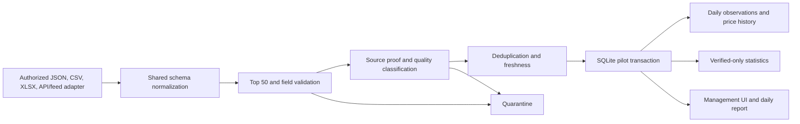

# Phase F1 — Live data ingestion pilot

Status reviewed: **2026-10-15**. This is an isolated pilot for current listing
intake. It does not migrate historical records or write to the production or
demo warehouse.

## Runtime boundary

The pipeline stores only to `state/ward_prices.ingestion_pilot.sqlite3`. It
reads the Top 50 target registry from `state/ward_prices.sqlite3` in read-only
mode and copies the 50 target labels into the pilot. It never copies listings
from production, `state/ward_prices.demo.sqlite3`,
`state/ward_prices.historical_pilot.sqlite3`, or the Gemini Web audit database.
The target registry sync is the only production-database access in this flow.

The JSON registry in `config/ingestion_sources.json` currently has no enabled
source. All websites and proposed providers remain `REVIEW_REQUIRED`, with
storage permission false. The pipeline has no network client. A file can be
written to the pilot only after the source passes `AUTHORIZED`, `enabled`, and
`storage_permission` checks.

## Pipeline



The JSON, CSV, and XLSX paths reuse `wardprice.price_warehouse.load_listing_payload`
for input decoding. Administrative normalization, canonical URL handling, and
the existing collector's direct-page evidence are reused where applicable.
`wardprice.ingestion_pilot` adds the shared pilot schema, permission gate,
Top 50 match, deduplication, freshness, price history, audit runs, inbox flow,
monitoring API and isolated report generation.

## Pilot schema

| Table | Purpose |
|---|---|
| `ingestion_sources` | Source permission record, scope, frequency, storage and attribution. |
| `ingestion_targets` | Read-only copy of the 50 approved target identities. |
| `ingestion_runs` | Per-file/job audit, counts, status and SHA-256. |
| `ingestion_files` | Imported file identity and latest observation date. |
| `ingestion_listings` | One current candidate per listing identity, normalized fields and quality state. |
| `ingestion_listing_sources` | Source-specific identifiers, URL, attribution and payload. |
| `ingestion_observations` | Idempotent listing/source/day snapshots. |
| `ingestion_price_history` | Same-listing price changes by day. |
| `ingestion_quarantine` | Rejected rows with reason and contact-like values redacted. |
| `ingestion_daily_statistics` | Python-computed daily aggregates eligible for verified listing evidence only. |

The common input accepts `listing_uid` or source identifiers/URL/fingerprint,
`source_id`, target rank or exact Top 50 identity, title, address, property and
transaction types, total price, area, URL, evidence, publication date and expiry.
Missing facts remain missing; price per square metre is computed in Python only
when positive price and area are both present. A category/search URL is never a
listing identity. Duplicate identity prefers source listing ID, then canonical
direct URL, then the multi-field content fingerprint.

## Evidence and statistics

`SOURCE_PAGE_CONFIRMED` requires a direct listing URL and either:

1. evidence passed out-of-band by `ingest_collector_result()` from the existing
   collector's fetched-page hash, visible price/area matches and address match; or
2. explicit operator verification with reviewer, reference and field evidence.

Fields embedded in an imported JSON or CSV cannot self-assert that proof. Other
records remain `SOURCE_PARTIAL`, `SEARCH_SNIPPET_ONLY`, `CATEGORY_ONLY`, or
`UNVERIFIED`; none enters verified statistics. A statistic requires a valid Top
50 address, direct listing URL, confirmed source page, known property type,
explicit `SALE`, positive price and area, and no confirmed expiry. Rent and
unknown transaction types stay out. Mean, median, min, max and listing count are
computed in Python and grouped by target and property type.

`NEWLY_POSTED_LAST_24H` requires both a source-level authoritative publication
date capability and record-level publication-date evidence. A first-seen record
without that proof is `NEWLY_DISCOVERED`, not newly posted. Replaying the same
file on the same day updates the same observation; an unchanged snapshot on the
next day creates the next day's observation. Price changes are recorded once
per listing/day. Confirmed expiry is retained on refresh and removes the
listing from eligible statistics.

## CLI (PowerShell)

Run from the project folder. `ingest` previews by default and makes no database
change until `--apply` is supplied:

```powershell
Set-Location 'D:\Work\FPT\Data science\WardPriceDaily'
$Python = '.\.venv\Scripts\python.exe'

# Initialize or refresh the isolated pilot schema and Top 50 source registry.
& $Python -m wardprice.ingestion_pilot init

# Inspect all current source permission gates and pilot coverage.
& $Python -m wardprice.ingestion_pilot sources
& $Python -m wardprice.ingestion_pilot status

# Preview a batch (use the configured source_id; it must be authorized first).
& $Python -m wardprice.ingestion_pilot ingest `
  --file '.\inbox\partner_batch.json' --source-id 'partner-json-template'

# After permission fields are reviewed and the preview is clean, apply it.
& $Python -m wardprice.ingestion_pilot ingest `
  --file '.\inbox\partner_batch.json' --source-id 'partner-json-template' --apply

# Process files placed in data\inbox; preview first, then explicitly apply.
& $Python -m wardprice.ingestion_pilot inbox
& $Python -m wardprice.ingestion_pilot inbox --apply --source-id 'partner-json-template'

# Refresh the local dashboard report; no email is sent.
& $Python -m wardprice.ingestion_pilot report

# Preview the 08:00 Asia/Ho_Chi_Minh workflow. It does not register a task.
& .\scripts\run_ingestion_scheduler_dry_run.ps1

# Optional, disposable synthetic performance test; never writes pilot/production.
& $Python -m wardprice.ingestion_pilot benchmark --count 500
```

To enable file-drop watching later, set `file_drop_enabled` in
`config/ingestion_pipeline.json` only after source authorization and operational
review. The watcher requires `--apply`. The Phase F1 scheduler dry-run script
does not create or modify any Windows Task Scheduler task. No Gmail send path is
connected to this pilot.

The maximum single input is 10,000 rows so the 500/day goal is not a processing
ceiling. The system reports the 500/day aggregate goal and a 10/day per-target
planning goal separately. It never fills either target with repeated or
synthetic records.

## File-drop states and outputs

`data/inbox/` accepts `.json`, `.csv`, and `.xlsx`. An applied file is first
moved to `data/processing/`, then to `data/processed/`; a permission-blocked or
invalid file goes to `data/quarantine/`. A file still changing on disk is
deferred. These folders are git-ignored because they can contain licensed
listing content. Daily JSON/CSV reports are written under `outputs/ingestion/`;
they do not send email.

The FastAPI management dashboard is `/ingestion-pilot`; its read-only data
routes are `/api/v1/ingestion/monitoring` and `/api/v1/ingestion/listings`.
Coverage separates candidate count from verified count, and reports the
per-target `NEWLY_POSTED_LAST_24H` count against 10 without implying the goal was
met.
